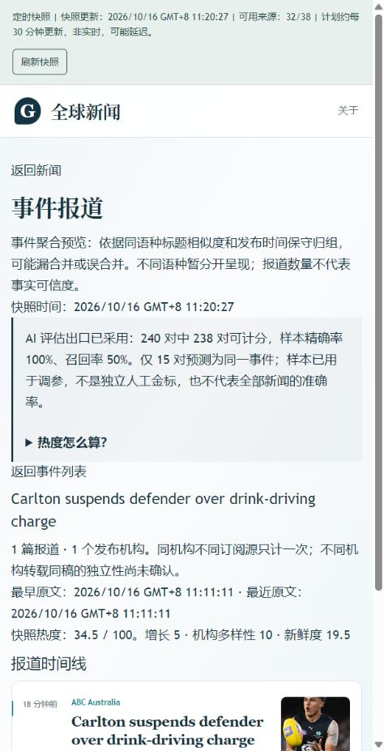

# News V1.0.0 final handoff

Date: 2026-10-16, Asia/Shanghai.

## Final disposition

**RELEASED WITH WARNINGS.** The owner explicitly permitted recording incomplete
gates as V1.0.0 release waivers. The original thresholds, failures and missing
evidence remain unchanged. A formal version was published; full original gate
compliance is **not** claimed.

| Identity | Authoritative result |
| --- | --- |
| Public website | https://aureliuswu.github.io/News/ |
| GitHub Release | https://github.com/AureliusWu/News/releases/tag/v1.0.0 |
| Version/tag | `1.0.0` / `v1.0.0`, not draft or prerelease |
| Tested, tagged and deployed source | `31cf95d6ae471bb961eb5b85a334ec78f4cce260` |
| Release published | 2026-10-16 11:37:44 Asia/Shanghai, `2026-10-16T03:37:44Z` |
| Final verification CI | [38844143633](https://github.com/AureliusWu/News/actions/runs/38844143633), success |
| Pages build and deploy | [38844955158](https://github.com/AureliusWu/News/actions/runs/38844955158), success |
| Public metadata | `formal_release=true`, `release_status=RELEASED_WITH_WARNINGS`, five explicit waivers |

The tag deliberately identifies the exact tested and deployed source. A later
documentation-only `main` commit records post-release evidence without retagging
or silently rebuilding a different application.

## Changes in this release closure

- Frontend version advanced from `0.9.0-alpha.1` to `1.0.0`.
- Stable release metadata requires a matching, explicit owner-approved record;
  it exposes the waivers instead of converting failed gates into passes.
- The observer now binds future observations to version `1.0.0`. Old-version
  samples are retained, not repurposed to manufacture the new version's history.
- Frozen CI source-health validation uses its actual `snapshot_id`, `checked_at`
  and summary/check contracts, while event hash binding remains strict.
- Chrome uses the supported installed channel with sandboxing still enabled.
- Lighthouse uses supported CLI URL blocking without a config file overriding
  `--preset`; reported viewport, network and CPU settings are now verified.
- Backend and snapshot collector dependencies use separate isolated Python
  environments, retaining their different PyYAML pins without forced upgrades.

No Cloudflare work, billing changes, new credentials or Docker operation was
needed. Content-generation AI remains disabled with zero budgets. No original
failed observation, test result or source timestamp was rewritten.

## Actual automated checks

| Check | Result | Scope |
| --- | --- | --- |
| Backend pytest | 121 passed, one warning | Linux CI, Python 3.12; not Windows host-level runtime acceptance |
| Snapshot unittest | 60 passed | Normalization, events, evidence, corrections, archives and publication predicates |
| Exact restoration unittest | 16 passed | Restoration logic; not a new production rollback drill |
| Frontend Vitest | 136 passed, 10 files | Current candidate |
| Node release/policy/binding tests | 23 passed | Includes six new explicit-approval guard tests |
| Vue/TypeScript | Passed | Candidate CI build environment |
| Vite/PWA builds | Passed | Both comparison clients; production Pages also ran its build/PWA checks |
| Browser cases | 8 passed, 2 skipped, zero unexpected or flaky | Chrome 155.0.8059.39 and Firefox 157.0 |

Total: **356 automated regression tests plus 8 browser cases passed**. The two
Firefox Service Worker cases are intentional out-of-scope skips, not passes.
The Actions Node-20-to-24 migration notice and the one backend warning remain
visible in raw logs; they did not cause a test failure.

Chrome proved news/bookmark reload persistence, library visibility, event
navigation and direct detail reload, 390px geometry, cached offline reload and
same-origin old-client upgrade with a preserved test bookmark. The actual older
source was `5e55cf7d5a5014bc4c55b7f9aad18bbede966380`; the new source is the tag
commit above. No synthetic Service Worker, forced skipWaiting, cleared storage or
disabled sandbox was substituted for these cases. Firefox proved the online
bookmark, event/deep-reload and 390px cases only.

## Corrected controlled performance diagnostic

One exact frozen input was used for both builds: snapshot
`2df73516a8984781af6eb8fa`, 785 articles. Three cold samples per arm/device ran in
alternating AB/BA order on the same runner. All twelve reports matched their
declared form factor, viewport, network and CPU settings and fetched one news
JSON response. Original reports remain attached.

| LCP, ms | Previous 0.9 source median / worst | V1.0.0 median / worst |
| --- | ---: | ---: |
| Desktop | 920.806 / 924.969 | 913.336 / 915.199 |
| Mobile simulation | 3925.277 / 3929.086 | 3717.132 / 3721.044 |

Desktop used 1350x940, DPR 1, RTT 40ms, 10240Kbps, CPU x1. Mobile used 412x823,
DPR 1.75, RTT 150ms, 1638.4Kbps, CPU x4. Storage was reset. Third-party HTTPS
resources were blocked in both arms to isolate startup; loopback delivery is not
the public CDN. Small-sample directional differences are not a proven public SLA
or a replacement for real interaction measurements.

**Performance budget: NOT PASSED / WAIVED FOR THIS RELEASE.** The unchanged
3,000ms budget is exceeded. Successful diagnostic execution means valid
measurement, not a performance pass. The historical public slow sample of
3267.856ms is also retained.

## Actual production smoke

- The first complete post-deployment observation at
  `2026-10-16T03:22:20.928Z` saw Chinese HTML and release/data/health HTTP 200.
- Public release metadata reported version `1.0.0`, the exact source/tag commit,
  formal release and the owner-approved warning disposition.
- The published snapshot was `13368837cfe17c5157ec08aa`, generated at
  `2026-10-16T03:20:27.113767Z`, with 785 articles, 32/38 healthy feeds, 22
  publishers, nine regions and four languages. At the first observation its age
  was about 1.90 minutes, passing the two-hour check.
- Public HTML and **22 static resources** matched the tested CI frontend
  byte-for-byte. Immutable events and source-health assets belonged to the same
  generation. An intentionally missing JSON resource returned 404 rather than
  being mistaken for successful JSON.
- The in-app browser visibly rendered thirty home cards and footer `V1.0.0`.
  The previous cached 0.9 page reached the new version through the normal
  check-for-update control, without deleting caches or bookmarks.
- Direct event URL
  `/News/events/e_49f80c7c9078c0c789d20d64` rendered its reporting timeline and
  original ABC source link, with no captured console errors.

**Production smoke: PASS WITH WARNINGS**, not universal browser acceptance.
One in-app-browser event-link click did not change route. Chrome/Firefox CI
navigation passed, and direct public detail navigation rendered. Its root cause
is not established; no speculative routing patch was made. GitHub Pages returned
HTTP 404 for the direct event URL while serving the verified SPA shell, which the
live browser rendered. Both observations remain disclosed compatibility warnings.

The site uses snapshot JSON, not a hosted native backend API. The producer's
`0.4.0-alpha.1` identifier is not the frontend version. No nonexistent public
`/api/v1/health` endpoint is claimed healthy.



## Explicit release exceptions, not fabricated passes

The [owner waiver record](V1.0.0_RELEASE_WAIVERS.md) and
[machine-readable approval](../release-acceptance.json) preserve five categories:

| Category | Actual remaining state | Release disposition |
| --- | --- | --- |
| Seven-day coverage/reliable scheduling | First version-1.0 report WARMING_UP, 0/336 closed slots, 168-hour span not established | Waived, not passed |
| Public performance/real interaction | Budget exceeded; real interaction latency not measured | Waived, not passed |
| Real phone | No physical-device/browser/operation receipt | Waived, not passed |
| Complete historical/PWA matrix | One Chrome version pair passed; full installed/device/browser matrix incomplete | Missing matrix waived |
| Windows full start/stop/fault injection | Earlier execution-policy-blocked scope remains unexecuted | Waived, not bypassed |

The first V1.0.0 observation was in the then-open half-hour slot. Its first gate
calculation at `2026-10-16T03:22:27.504Z` covered the window ending 03:00Z and
correctly had zero qualifying closed slots. The original CLI returned business
exit code 1. Old 0.9 history stays in the history file but cannot qualify the new
version. The older 16/336 (4.76%) result is not asserted as current V1.0.0 coverage.

The original 168-hour, 336-slot, >=95%, two-hour and 3,000ms requirements are
unchanged. Independent observer/publisher success is not substituted for these
requirements. No seven-day history was backfilled. Cloudflare remains deferred.

## Preserved failures and correction evidence

- [38706750587](https://github.com/AureliusWu/News/actions/runs/38706750587): the first harness wrongly expected event-only fields on source-health; browser/performance cases did not run.
- [38708078006](https://github.com/AureliusWu/News/actions/runs/38708078006): three Firefox online cases passed, five bundled-Chromium starts failed sandboxing, two Firefox cases skipped. The nominal desktop Lighthouse group actually used mobile defaults because a config file overrode the preset; it is not accepted as desktop evidence.
- [38710803356](https://github.com/AureliusWu/News/actions/runs/38710803356): incompatible PyYAML pins were combined; dependencies failed before tests. Separate environments resolved the conflict without changing the pins.
- [38844143633](https://github.com/AureliusWu/News/actions/runs/38844143633): actual corrected final run passed its regression/browser stages and produced twelve valid, correctly configured performance samples, whose mobile budget still fails.

The [pre-fix errata](evidence/v1.0.0-release-20261016/pre-fix-errata.json) explains
why the earlier `all_samples_valid` flag was insufficient. Original raw reports
and labels are retained, not edited to look correct.

## Rollback and permanent archives

The exact previous app plus original data from publisher run `38702292514` is
backed up and attached to the release. Its archive SHA-256 is
`d8137b04c25a39dce22ae7bb67d33e97d9fe4d8c66d51a2e116eb75203c0360d`.
The exact published V1.0.0 Pages archive from run `38844955158` is also attached,
SHA-256 `5c0b94fdd4704e44880c2d314e2c36f968183415272d34117b455ef08ac6d839`.

While the corresponding Actions artifacts remain available, an operator can use
the existing paired restoration workflow, choosing exactly one source:

```powershell
gh workflow run restore-pages.yml --ref main -f source_run_id=38702292514
```

For the initial V1.0.0 app/data pair, the source run is `38844955158`. These
commands are documented, **not executed** by this release. They do not recollect
news or rewrite dates. After Actions artifact expiration, retained release archives
still preserve the bytes for manual recovery; automatic restoration from a
release-asset URL is not claimed to be implemented.

Six release attachments retain final CI evidence, the earlier browser failure
archive, previous paired Pages bytes, published V1.0.0 Pages bytes, public smoke
and the approval record. GitHub returned matching SHA-256 digests for all six.

## Evidence index and workspace boundary

- [Verification summary](evidence/v1.0.0-release-20261016/verification-summary.json)
- [Final verification run](evidence/v1.0.0-release-20261016/verification-run.json) and [jobs](evidence/v1.0.0-release-20261016/verification-jobs.json)
- [Deployment run](evidence/v1.0.0-release-20261016/deployment-run.json) and [jobs](evidence/v1.0.0-release-20261016/deployment-jobs.json)
- [Public HTTP smoke and asset digests](evidence/v1.0.0-release-20261016/public-http-smoke.json)
- [Live browser receipt](evidence/v1.0.0-release-20261016/public-browser.json)
- [Published release metadata](evidence/v1.0.0-release-20261016/public-release.json)
- [Canonical HTTP observation](evidence/v1.0.0-release-20261016/public-observation.json)
- [First V1.0 freshness report](evidence/v1.0.0-release-20261016/freshness-report.json) and [preserved history](evidence/v1.0.0-release-20261016/freshness-history.json)
- [Tag verification](evidence/v1.0.0-release-20261016/tag-verification.json) and [release attachment digests](evidence/v1.0.0-release-20261016/release-assets.json)
- [Copied raw evidence manifest](evidence/v1.0.0-release-20261016/evidence-manifest.json)

Raw test output is beside these receipts. Large exact-byte archives are release
attachments, not extra binary history in the source repository. Text checksums
refer to the copied source-byte/Git-blob newline form; Windows checkouts can
normalize text line endings, while the archived ZIP bytes remain exact.

The pre-existing untracked `frontend/tsconfig.node.tsbuildinfo` was preserved and
not committed. Existing local preview/dist output was not used to claim public
verification. No unrelated user changes were reverted or staged. The News home
tab remains open as the user-facing deliverable.
