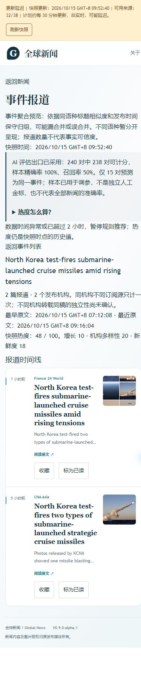

# V1 M5 Edge 公网操作验收补充（2026-10-15）

本轮 Edge 核心流程的限定验收结果为 **PASS**，V1.0.0 总发布门禁仍为 **未通过**。

## 验收对象与范围

- 公网入口：<https://aureliuswu.github.io/News/>。
- 浏览器：用户电脑上已连接的 Microsoft Edge，通过浏览器扩展实际操作。
- 页面显示版本：`0.9.0-alpha.1`；独立 HTTP 发布回执确认 `stage=M5-candidate`、`formal_release=false`。
- 发布回执采集时间：`2026-10-15T06:47:45.326Z`，HTTP `200`。
- 线上应用源码修订：`3032b0fbdea9203c9a83c72269cb5b7882e61358`，构建时间 `2026-10-13T15:38:52.789Z`。
- 核心流程开始于 `2026-10-15T05:32` 左右；机器证据完成于 `2026-10-15T06:47:14.748Z`。中间包含用户主动中断及恢复。
- 本轮只补齐 Edge 的页面操作证据。此前 Chrome 结果及 Edge 首次超时记录保留在 [桌面浏览器报告](V1_M5_DESKTOP_BROWSER_20261015.md)。

## 实际结果

| 检查 | 观察结果 | 结论 |
| --- | --- | --- |
| 首页进入事件列表 | 点击“事件聚合”，显示 777 个事件 | PASS |
| 多机构筛选 | 勾选“仅看多机构报道”，777 个事件缩小为 6 个 | PASS |
| 列表进入事件详情 | 普通点击事件链接，进入 `e_f85f03b66e4fa90b92e2a575` | PASS |
| 详情内容 | 两篇报道、两个发布机构，France 24 World 与 CNA Asia 均可见 | PASS |
| 收藏持久化 | 初始 `aria-pressed=false`；中断后重新打开为已收藏；实际刷新后仍为已收藏 | PASS |
| 收藏恢复 | 取消测试收藏后 `aria-pressed=false`，恢复初始值 | PASS |
| 窄屏布局 | 配置视口 390×844；文档可用宽度与滚动宽度均为 375px；两张报道卡片及四个操作按钮均在边界内 | PASS |
| 视口恢复 | 截图后在 `finally` 中成功重置临时视口 | PASS |

详情页的第二篇 CNA 报道标题为 `North Korea test-fires two types of submarine-launched strategic cruise missiles`。测试仅切换这一篇的收藏按钮，未清空浏览器收藏、缓存或站点存储。

首次普通点击进入详情的 DOM 证据采集于 `2026-10-15T05:35:29.270Z`。收藏点击期间用户主动中断，原测试标签随后已不存在；恢复时在同一 Edge 打开此前已经观察到的详情 URL。该次直接导航用于恢复收藏测试，列表到详情的点击验收依据中断前保存的 `detail.dom.txt`。

恢复后的实际刷新证据采集于 `2026-10-15T06:44:25.123Z`，按钮显示“已收藏”并具有 `[pressed]` 状态；恢复初始收藏值的回执时间为 `2026-10-15T06:45:15.992Z`。中断期间缺失的点击后回执未补造。

## 布局证据

390px 配置视口下，文档测得 `clientWidth=375`、`scrollWidth=375`。每张卡片边界约为左 `14.8px`、右 `360.4px`、宽 `345.6px`。机器回执保存各按钮的实际边界；截图已目视检查。

这项检查覆盖桌面 Edge 的响应式布局。真实手机、Firefox、实际断网和旧客户端升级仍需各自的运行证据。

## 发布门禁状态

页面仍显示“更新延迟”，快照时间为 `2026/10/15 GMT+8 09:52:40`、可用来源为 `32/38`；事件页提示数据超过两小时并暂停规则推荐。浏览器功能通过不能证明新鲜度通过。本轮没有重新计算完整七天观测窗口。

V1.0.0 仍需要关闭以下项目：

1. 七天独立观测覆盖与至少 95% 的新鲜度通过率。
2. 匹配环境下的多次性能实测，以及已有超时样本对应的性能问题。
3. Firefox 与真实移动设备验收。
4. 真实 PWA 断网使用和旧客户端升级矩阵。
5. 此前受执行环境拦截的完整本地启停及故障注入回归。

Cloudflare 部署继续遵照用户决定暂时跳过。当前应用保持 `0.9.0-alpha.1 / M5-candidate`，本轮没有创建 V1.0.0 标签或重新部署应用。

## 证据文件

- [浏览器机器回执](evidence/v1-m5-edge-completion-20261015/browser-evidence.json)。
- [独立 HTTP 发布回执](evidence/v1-m5-edge-completion-20261015/public-release.json)。
- [事件列表 DOM](evidence/v1-m5-edge-completion-20261015/events.dom.txt)。
- [多机构筛选 DOM](evidence/v1-m5-edge-completion-20261015/multi.dom.txt)。
- [普通点击后的详情 DOM](evidence/v1-m5-edge-completion-20261015/detail.dom.txt)。
- [实际刷新后的收藏 DOM](evidence/v1-m5-edge-completion-20261015/bookmark-after-reload.dom.txt)。

原始恢复检查点保存在本地 `artifacts/v1-m5-edge-completion-20261015/`。本轮未修改应用代码，未重复运行前后端测试或构建；未处理既有的 `frontend/tsconfig.node.tsbuildinfo`。
