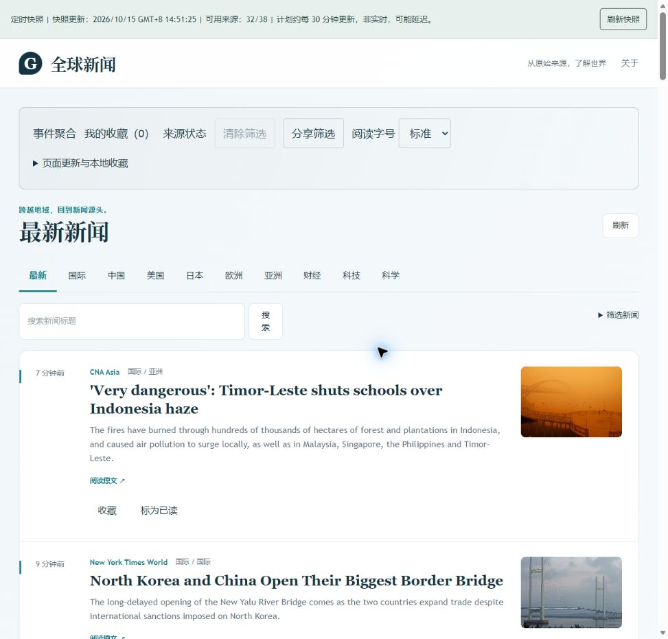

# V1 M5 公网快照恢复与七天门禁复算（2026-10-15）

当前新闻快照已通过现有 GitHub Actions 发布流程恢复更新，独立 HTTP 与 Edge 页面实测均确认新快照可用。V1.0.0 总发布门禁仍未通过，七天新鲜度通过率为 **15/336，约 4.46%**。

## 发布与独立观测

- [发布运行 38694897709](https://github.com/AureliusWu/News/actions/runs/38694897709)：`workflow_dispatch`，源码修订 `c03f23e1d9c9c2c86b1c368d49af283d3a4e0e43`，构建与部署均成功。
- 发布创建于 `2026-10-15T06:50:53Z`，构建完成于 `06:51:42Z`，部署完成于 `06:52:06Z`。
- [独立观察运行 38695345350](https://github.com/AureliusWu/News/actions/runs/38695345350)：同一修订，实际执行并成功保存独立 HTTP 历史。该工作流成功不等于七天门禁通过。
- 应用仍为 `0.9.0-alpha.1 / M5-candidate`，`formal_release=false`；本轮未创建 V1.0.0 标签。

| 实测项 | 发布前线上状态 | 发布后线上状态 |
| --- | --- | --- |
| 独立 HTTP 采样时刻（UTC） | 2026-10-15T06:51:35.824Z | 2026-10-15T06:52:51.685Z |
| 快照生成时间（UTC） | 2026-10-15T01:52:40.799506Z | 2026-10-15T06:51:25.514968Z |
| 快照年龄 | 约 4.98 小时 | 约 86 秒 |
| 两小时新鲜度 | FAIL | PASS |
| 新闻条数 | 785 | 788 |
| 可用来源 | 32/38 | 32/38 |
| 发布机构 | 22 | 22 |
| 新闻与来源报告同代 | 是 | 是 |
| 快照 ID | e6ad706d2e871ec2c0bb5a65 | d44675ffd0665683c0b701a2 |
| 应用源码修订 | 3032b0fbdea9203c9a83c72269cb5b7882e61358 | c03f23e1d9c9c2c86b1c368d49af283d3a4e0e43 |

两次观测中的中文 HTML、新闻 JSON、来源健康 JSON 和发布元数据均实际请求成功，且新闻与来源报告匹配。原始失败样本与新鲜样本同时保留。快照内 `meta.version=0.4.0-alpha.1` 与应用发布版本是两个字段，应用版本以 `release.json` 的 `0.9.0-alpha.1` 绑定。

## 实际页面与 CI 结果

Edge 公网页面证据保存于 `2026-10-15T06:55:21.814Z`。页面显示“定时快照”、北京时间 `2026/10/15 GMT+8 14:51:25` 和 `32/38` 可用来源；本次 DOM 未显示“更新延迟”或缓存过时提示。截图已目视检查。

本次发布工作流实际执行的检查：

- 发布规则与独立门禁测试：17 项通过、0 项失败。
- 快照规范化与发布门禁测试：60 项通过。
- 前端测试：9 个测试文件通过。
- Vue 与 TypeScript 类型检查、前端构建：通过。
- 静态 PWA 构建检查：通过，`/News/` 路径、`/News/favicon.svg`、中文 manifest 及 15 项预缓存资源正确。

相关 Actions 步骤包含 `punycode`、`url.parse()` 弃用提示，保留在 CI 摘录中。此次发布工作流没有执行原生后端 pytest、真实断网、旧客户端升级或完整本地启停/故障注入测试。

## 定时更新问题的证据与限制

现有发布工作流配置 `17,47 * * * *`，独立观察器配置 `8,38 * * * *`。实际 HTTP 观测附带的 GitHub 历史显示，近七天仅有 **31 次定时发布**，相邻定时发布最长间隔约 **10.02 小时**。最近两次定时发布创建时间为 `2026-10-14T23:29:36Z` 与 `2026-10-15T01:52:04Z`，间隔约 2 小时 22 分钟；已触发的这两次任务均成功。

这些证据确认了实际触发频率不足。GitHub 官方说明，[定时工作流在高负载时可能延迟，部分排队任务可能被丢弃](https://docs.github.com/en/actions/how-tos/troubleshoot-workflows)。现有证据不能确定每个缺失触发的具体平台原因。本轮手动发布恢复了当前快照，尚未证明长期触发频率得到修复。

本轮继续使用原有工作流，未调整 cron、验收门槛、GitHub 隐私设置或全局 Git 配置。Cloudflare 部署继续遵照用户决定暂时跳过。

## 合并历史后的七天门禁

复算输入包括此前保留的 **67 个标准化输入文件**、本轮新增的两次本地独立 HTTP 观测，以及本轮云端独立观察器历史。原始输入未改写，旧失败与时间字符串副本继续保留。

最终合并报告评估时刻为 `2026-10-15T06:57:23.307Z`：

| 指标 | 结果 |
| --- | --- |
| 完整闭合窗口 | 2026-10-08T06:30:00.000Z 至 2026-10-15T06:30:00.000Z |
| 候选版本绑定 | 0.9.0-alpha.1，已绑定 |
| 应有半小时槽 | 336 |
| 有观测槽 | 34 |
| 通过槽 | 15 |
| 失败槽 | 19 |
| 缺失槽 | 302 |
| 通过率 | 4.464285714285714%，要求至少 95% |
| 实际观测跨度 | 约 185.69 小时，最低要求 168 小时 |
| 门禁结论 | FAIL；gate_pass=false；formal_release=false |
| 门禁 CLI 退出码 | 1，表示业务门禁未通过 |

本轮 06:51、06:52 及云端约 06:55 的观测属于尚未闭合的 `06:30–07:00 UTC` 槽，已保留在历史中。闭合窗口统计没有提前计入这个槽；同槽中的陈旧失败样本也没有被随后的新鲜样本覆盖。云端单独历史的报告与合并本地历史后的报告范围不同，分别保存。

## 证据与后续发布条件

- [发布运行元数据](evidence/v1-m5-refresh-recovery-20261015/publish-run.json)。
- [独立观察运行元数据](evidence/v1-m5-refresh-recovery-20261015/observer-run.json)。
- [CI 摘录](evidence/v1-m5-refresh-recovery-20261015/ci-evidence.txt)。
- [发布前失败观测](evidence/v1-m5-refresh-recovery-20261015/before-observation.json)。
- [发布后新鲜观测](evidence/v1-m5-refresh-recovery-20261015/after-observation.json)。
- [Edge 页面回执](evidence/v1-m5-refresh-recovery-20261015/browser-evidence.json)。
- [Edge 页面 DOM](evidence/v1-m5-refresh-recovery-20261015/edge-home-after.dom.txt)。
- [最终合并门禁报告](evidence/v1-m5-refresh-recovery-20261015/report-combined-final.json)。
- [最终合并历史](evidence/v1-m5-refresh-recovery-20261015/history-combined-final.json)。
- [云端独立门禁报告](evidence/v1-m5-refresh-recovery-20261015/observer-after-report.json)。

仍需取得可靠定时触发及完整七天新鲜度证据，完成性能、Firefox、真实手机、真实 PWA 断网及旧客户端升级验收，并处理此前被执行环境拦截的完整启停/故障注入回归。本轮不将当前单点新鲜度与 CI 成功解释为正式发布通过。

本轮未修改应用代码或工作流文件，既有 `frontend/tsconfig.node.tsbuildinfo` 保留原状。
