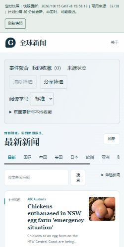

# V1 M5 首页快照预热与实测（2026-10-15）

首页快照预热已部署，六次冷启动实测均确认新闻 JSON 与 Vue 主包并行下载，而且每次只下载一份新闻 JSON。**移动 LCP 最慢仍为 3.268 秒，性能门禁未通过，尚不能宣称取得首屏性能收益。**

## 发布内容

- 应用修订：`3a3e0dcf0baf39ceacd0d4a65e015a80b3761333`。
- [发布运行 38702292514](https://github.com/AureliusWu/News/actions/runs/38702292514) 成功，部署步骤完成于 `2026-10-15T07:58:58Z`。
- 应用版本保持 `0.9.0-alpha.1 / M5-candidate`，`formal_release=false`。

此前入口只导入 Vue 主模块，首页在挂载后才请求新闻。本轮在快照模式的首页入口启动现有提供器的 `meta` 请求，与 Vue 主模块下载并行；正常页面复用同一个已验证快照和进行中的下载。

API 构建和其他路由不执行这项预取。全局 `fetch`、快照验证、缓存回退及分页代际规则保持原有职责；预热失败由正常页面请求继续处理，不形成成功的空新闻。没有新增运行时依赖或外部基础设施。

## 验证结果

| 检查 | 结果 |
| --- | --- |
| 前端测试 | 10 个测试文件、136 项通过 |
| 新增预热测试 | 9 项通过，覆盖根路径、项目路径、下载共享、API/路由隔离、失败重试和缓存回退 |
| Vue 与 TypeScript 检查 | 通过 |
| `/News/` 快照构建 | 通过 |
| `/` API 构建 | 通过 |
| 两种构建的静态 PWA 检查 | 通过，各 16 项预缓存资源 |
| CI 构建及 Pages 部署 | 成功 |

初次类型检查发现新增测试桩未声明 `fetch` 参数，触发 `TS2493`；已补齐测试签名，随后类型检查通过。初始失败诊断单独保留，未将它描述为一次全绿验证。

本地构建和类型检查输出均使用隔离的 `artifacts/v1-m5-startup-warmup-20261015/` 目录。既有 `frontend/dist` 未作为输出目标，既有 `frontend/tsconfig.node.tsbuildinfo` 未作为类型检查输出目标。本轮没有执行原生后端 pytest 或此前被拦截的本地启停/故障注入回归。

## 公网冷启动测量

使用 Lighthouse `13.5.0`、Chrome `155`，依次执行三次桌面和三次移动模拟导航。测量沿用冷配置文件、存储重置、`simulate` 节流和原有三秒 LCP 门槛。

桌面配置为 1350×940、40ms RTT、10240Kbps、CPU 系数 1；移动模拟为 412×823、设备像素比 1.75、150ms RTT、1638.4Kbps、CPU 系数 4。机器回执逐项确认这些控制参数与原配置一致。

组前、组后 HTTP 探针确认应用修订和新闻响应内容未变化，快照 ID 均为 `35b7edde202b3e2dcaf1c299`。六次 LCP 元素均属于实际新闻卡片，不是加载横幅或空页面。

| 样本 | 模拟 LCP / ms | TBT / ms | CLS | 新闻 JSON 请求数 | 与主包下载重叠 |
| --- | ---: | ---: | ---: | ---: | --- |
| desktop-1 | 752.321 | 0 | 0.000527 | 1 | 是 |
| desktop-2 | 1521.466 | 0 | 0.000441 | 1 | 是 |
| desktop-3 | 770.608 | 0 | 0.000441 | 1 | 是 |
| mobile-1 | 2833.579 | 106 | 0.022156 | 1 | 是 |
| mobile-2 | 2516.554 | 157 | 0.022156 | 1 | 是 |
| mobile-3 | 3267.856 | 102 | 0.022156 | 1 | 是 |

每次均未产生实际公网 `/api/v1/` 请求，没有 HTTP 错误或 Lighthouse 运行警告。新闻请求的实际开始时间早于主包完成时间：

| 样本 | 新闻开始 / ms | 主包完成 / ms |
| --- | ---: | ---: |
| desktop-1 | 755.848 | 1248.348 |
| desktop-2 | 413.638 | 698.064 |
| desktop-3 | 804.813 | 1170.332 |
| mobile-1 | 515.931 | 721.525 |
| mobile-2 | 687.191 | 1024.034 |
| mobile-3 | 477.629 | 838.875 |

因此，请求并行和单次下载这两项行为已得到运行证据支持。它们不能替代首屏性能验收。

| 指标 | 上一组 `5e55cf7` | 本组 `3a3e0dc` |
| --- | ---: | ---: |
| 桌面 LCP 中位数 / ms | 767.268 | 770.608 |
| 桌面 LCP 最慢 / ms | 802.962 | 1521.466 |
| 移动模拟 LCP 中位数 / ms | 2292.186 | 2833.579 |
| 移动模拟 LCP 最慢 / ms | 3191.828 | 3267.856 |

移动中位数的数值比上一组更高。前后组新闻快照、标题和图片内容不同，尚不能据此确认由代码造成的回归，也不能宣称优化收益。下一步应使用同一冻结输入做对照，确认是否保留或回退这项预热；已有慢样本全部保留。

当前六次中有一次超过三秒，实验室 LCP 门禁为 **NOT_PASSED**。TBT 不等于真实交互延迟，移动模拟也不等于真实手机验收。

## 独立 HTTP 与七天新鲜度

`2026-10-15T08:15:32.455Z` 的实际公网观测确认：

- 中文 HTML、新闻 JSON、来源报告与发布元数据请求成功。
- 应用修订为 `3a3e0dcf0baf39ceacd0d4a65e015a80b3761333`。
- 快照生成于 `2026-10-15T07:58:18.169271Z`，共 806 条新闻，32/38 个可用来源、22 个发布机构。
- 新闻与来源报告属于同一代，采样时快照年龄约 17.24 分钟，两小时新鲜度通过。

`2026-10-15T08:16:08.031Z` 的七天闭合窗口复算结果：

| 指标 | 结果 |
| --- | --- |
| 闭合窗口 | 2026-10-08T08:00:00.000Z 至 2026-10-15T08:00:00.000Z |
| 应有 / 有观测槽 | 336 / 36 |
| 通过 / 失败 / 缺失槽 | 16 / 20 / 300 |
| 通过率 | 4.761904761904762%，要求至少 95% |
| 观测跨度 | 约 187.03 小时 |
| 门禁结果 | FAIL，候选版本绑定有效，CLI 退出码 1 |

历史失败与缺失槽保留，性能探针未被当作完整独立观测补入。08:15 的观测属于下一未闭合槽；本次通过槽增加来自此前已实际采集的观测进入闭合窗口，不是回填历史。

## 证据与剩余项目

- [验证回执](evidence/v1-m5-startup-warmup-20261015/validation.json)、[前端测试输出](evidence/v1-m5-startup-warmup-20261015/frontend-tests.txt)。
- [初始类型检查失败](evidence/v1-m5-startup-warmup-20261015/initial-typecheck-failure.json)、[后续通过回执](evidence/v1-m5-startup-warmup-20261015/typecheck.json)。
- [CI 运行元数据](evidence/v1-m5-startup-warmup-20261015/ci-run.json)。
- [性能及请求顺序机器回执](evidence/v1-m5-startup-warmup-20261015/summary.json)、[全部六份原始 Lighthouse 报告](evidence/v1-m5-startup-warmup-20261015/lighthouse-raw.zip)。
- [组前发布探针](evidence/v1-m5-startup-warmup-20261015/public-before.json)、[组后发布探针](evidence/v1-m5-startup-warmup-20261015/public-after.json)。
- [发布后完整 HTTP 观测](evidence/v1-m5-startup-warmup-20261015/post-deploy-observation.json)。
- [七天门禁报告](evidence/v1-m5-startup-warmup-20261015/freshness-report.json)、[保留的历史](evidence/v1-m5-startup-warmup-20261015/freshness-history.json)。

仍需完成同输入性能对照及移动尾延迟处理、实际交互性能、可靠定时触发与七天覆盖、Firefox、真实手机、真实 ServiceWorker 离线及旧客户端升级，以及此前受执行环境拦截的完整本地启停/故障注入验收。独立 CI 浏览器测试可继续补齐可自动化部分，但不替代真实手机或被拦截的本地验收。Cloudflare 继续暂时跳过，未创建正式 V1.0.0 发布。
